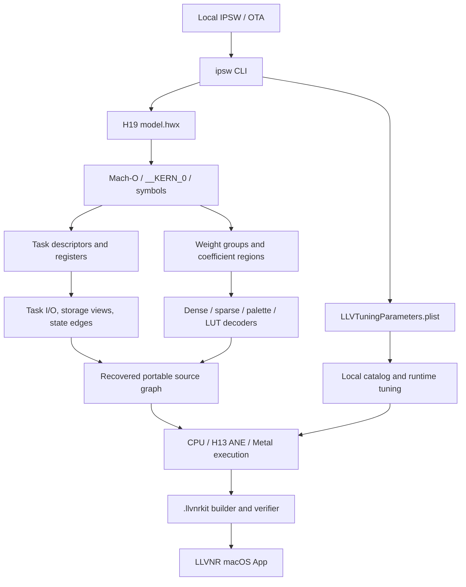

# LLVNR-Model-Research

LLVNR H19 低光降噪模型的本地研究、格式解析、权重解码、图重建和 Mac 运行时适配。

本仓库不提供模型权重，也不提供可直接运行的模型产物。模型、tuning 和运行资产由使用者从自己有权使用的本地材料生成。

**快速入口：** [LLVNR Demo](#llvnr-demo) · [模型提取](#从本地-ipswota-提取模型) · [模型原理图](#模型原理图) · [转换流程](#转换流程) · [v1.0 Release](https://github.com/21Z121Z1/LLVNR-Model-Research/releases/tag/v1.0)

## 目录

- [模型范围](#模型范围)
- [从本地 IPSW/OTA 提取模型](#从本地-ipswota-提取模型)
- [模型原理图](#模型原理图)
- [转换流程](#转换流程)
- [LLVNR Demo](#llvnr-demo)
- [仓库结构](#仓库结构)
- [v1.0](#v10)
- [文档](#文档)
- [License](#license)

## 模型范围

当前研究针对 V63 后摄 LLVNR 的 12 个逻辑配置：

| 镜头 | 模型 | 画布 |
|---|---|---|
| SuperWide 0.5× | `LLV-HD-SuperWide-0.5x-v0.2.2` | 2304×1296 / 2464×1388 |
| SuperWide 1× | `LLV-HD-SuperWide-1x-v0.3.0` | 2304×1296 / 2464×1388 |
| Wide 1× | `LLV-HD-Wide-1x-v0.3.0` | 2304×1296 / 2464×1388 |
| Wide 2× | `LLV-HD-Wide-2x-v0.3.0` | 2304×1296 / 2464×1388 |
| Tele 4× | `LLV-HD-Tele-4x-v0.3.0` | 2304×1296 / 2464×1388 |
| Tele 8× | `LLV-HD-Tele-8x-v0.3.0` | 2304×1296 / 2464×1388 |

每套模型是独立的 H19 task graph，不是把所有镜头简单合并成一个大网络。它们在 V63、V64、V64s 目录下可能有不同的打包副本。

研究重点：

- HWX/Mach-O 中的 kernel section、symbol table 和 task state；
- dense FP16、sparse lane、mask、palette 和 LUT 权重格式；
- 535 个 task 到全帧逻辑算子的恢复；
- 递归 `his_frame` 状态和 `state_yuv` / `state_weight_band0` 回边；
- H19 图向 CPU reference、H13 ANE 和 Metal 精度路径的转换；
- 本地 `.llvnrkit` 资产包验证和 Mac App 运行。

## 从本地 IPSW/OTA 提取模型

提取入口是：

```text
demo/kit/extract_ipsw_assets.py
```

脚本只调用本机 `ipsw` CLI，不包含固件密钥，也不自行下载或解密。它严格匹配 `ISPKit.framework/<V63|V64|V64s>/LowLightVideo` 下的：

- `LLV-HD-*.bundle/H19.bundle/main/main_ane/model.hwx`
- `*LLVTuningParameters.plist`

示例：

```bash
python3 demo/kit/extract_ipsw_assets.py /path/to/local.aea \
  --variant V63 \
  --output /path/to/private/llvnr-extracted
```

默认要求 V63 的 **12 个模型**和 **6 个 tuning** 全部找到。探索新 OTA 时可以使用 `--allow-partial`，但这只表示调试用，不代表一套完整模型。

脚本会生成 `EXTRACT-MANIFEST.json`，包含相对路径、文件大小、SHA-256 和计数，不包含输入文件的绝对路径。提取结果只应保存在私有研究目录。

如果使用 restore IPSW，脚本会自动改用 `ipsw extract --files`；如果使用 OTA/AEA/ZIP，则使用 `ipsw ota extract`。

## 模型原理图



对应的低光时序数据流可以简化为：

```text
cur_frame ───────────────┐
his_frame ───────────────┼─> motion / alignment ─> temporal fusion
dnr_zoom_map ────────────┤                         │
fusion_zoom_map ─────────┘                         ├─> denoise graph
                                                   ├─> output reconstruction
                                                   └─> state_yuv feedback
```

### 输入与输出

以 2304×1296 画布为例，当前全帧源图的接口是：

| 名称 | 形状 | 含义 |
|---|---|---|
| `cur_frame` | `[1, 6, 648, 1152]` | 当前帧的 6 通道 YUV 特征 |
| `his_frame` | `[1, 6, 648, 1152]` | 上一轮递归历史 |
| `dnr_zoom_map` | `[1, 1, 324, 576]` | DNR 空间条件图 |
| `fusion_zoom_map` | `[1, 1, 324, 576]` | Fusion 时序条件图 |

输出包括：

- `out_yuv`：处理后图像/特征；
- `state_yuv`：供下一帧参考的历史状态；
- `state_weight_band0`：时间混合状态，具体 host feedback 语义仍需按素材和场景验证。

更大画布按模型自己的尺寸约定缩放；相机输入通常是 1080p，再经过边缘填充、分块和裁回。

### 535 个 task 的组成

H19 原始调度不是一个普通卷积网络：

- 535 个 task 通过 TileDMA、L2 buffer 和外部端口交换数据；
- task 包含卷积、pool、affine、LUT、absdiff、max、Haar/转置、状态混合等操作；
- 恢复后的全帧研究图压缩为约 104 个逻辑节点；
- `docs/TASK-TABLE.md` 给出每个 task 的输入/输出形状、空间、地址和 kernel group；
- `docs/FORMAT-AND-REGISTERS.md` 给出寄存器、section 和代码入口索引。

### 权重格式

恢复器区分以下结构：

- **Dense FP16**：多个输出 lane 共用 block，bias 位于 payload 前部；
- **Sparse**：2×2/3×3 stride-2 mask tree，mask 和 FP16 payload 交错；
- **Palette / embedded LUT**：激活和特殊系数按单独布局恢复；
- **Transpose/deconv**：4×4 权重位置由受控编译探针和独立 signed tensor 验证。

每个解码结果都要做 shape、address、finite 和 re-encode byte equality 检查。未识别的格式会 fail closed，不会静默替换成随机权重。

## 转换流程

### 1. 提取

```bash
python3 demo/kit/extract_ipsw_assets.py \
  /path/to/local.aea \
  --variant V63 \
  --output /path/to/private/llvnr-extracted
```

### 2. 解析 task 和权重

```text
research/work/h19_statewalk.py
research/work/h19_weightlib.py
research/work/h19_dense_codec.py
research/work/h19_sparse_codec.py
research/work/h19_sparse_extended.py
research/work/h19_sparse_stream.py
research/work/llvnr_ir.py
research/work/llvnr_taskflow.py
```

这一层读取 HWX 的 Mach-O section、kernel symbols、task state 和存储视图，输出结构化 IR、task 表和 coefficient candidate。

### 3. 恢复全帧图

```text
research/work/llvnr_port/graph/portable_ops.py
research/work/llvnr_port/graph/portable_graph.py
research/work/llvnr_port/graph/execute_numpy.py
research/work/llvnr_port/graph/native_reference.py
research/work/llvnr_port/graph/run_portable.py
```

把 535 个 task 调度转换为可复用的卷积、pool、PE、LUT、状态混合和输出节点。CPU 参考路径不依赖 ANE，可以先验证图、系数、形状和递归状态。

### 4. 编译和运行

```text
research/work/llvnr_port/graph/metal_prefix.py
research/work/llvnr_port/graph/precision_runtime.py
research/work/llvnr_port/export_catalog_assets.py
```

ANE 路径依赖 Apple Silicon 上的私有 E5RT/Espresso 接口和可用的编译器运行时。精度敏感模型会拆出 Metal FP32 prefix，再将 denoiser 状态保存为 FP16。没有 ANE 时仍可使用 CPU reference。

### 5. 打包本地资产

```bash
python3 demo/kit/build_kit.py \
  --assets /path/to/private/model-assets \
  --catalog /path/to/private/catalog \
  --output /path/to/private/LLVNR-local.llvnrkit \
  --license /path/to/LICENSE-ANEForge.txt
```

生成后必须验证：

```bash
python3 demo/kit/verify_kit.py /path/to/private/LLVNR-local.llvnrkit
```

builder/verifier 会检查模型 manifest、tuning、文件哈希、模型 ID、ZIP 路径和夹带文件。资产包属于本地私人物料，不应上传到公开仓库。

## LLVNR Demo

`demo/` 是 LLVNR 研究的 macOS 参考运行器，也是从本地资产到实际画面的端到端验收界面。它不提供模型权重或可直接运行的模型产物；App 只导入使用者从本地材料生成、并通过 verifier 检查的 `.llvnrkit`。

主要功能：

- 导入本地模型资产包，支持未解压目录和 builder 生成的 ZIP；
- 使用本地摄像头实时运行模型，也可处理视频并导出结果；
- 在原始画面、处理后、滑动对比和并排对比之间切换，并同步缩放查看细节；
- 调整 DNR、Fusion 和 history update weight，暂停时重算当前帧；
- 保存处理前后的帧，查看帧率、队列、推理耗时和到达显示延迟；
- 重置递归时间状态，复现不同片段或参数从冷启动开始的行为。

从本地材料到 Demo 的运行链是：

```text
本地 IPSW / OTA
  -> extract_ipsw_assets.py
  -> H19 解析、权重解码和全帧图重建
  -> portable runtime assets + local catalog
  -> build_kit.py
  -> verify_kit.py
  -> LLVNR Demo
  -> 相机实时预览 / 视频处理与对比
```

### 运行已发布的 Demo

1. 从 [v1.0 Release](https://github.com/21Z121Z1/LLVNR-Model-Research/releases/tag/v1.0) 下载无权重 App 包。
2. 使用 [v1.0](#v10) 中的 SHA-256 校验下载文件。
3. 按[转换流程](#转换流程)在私有目录生成并验证 `.llvnrkit`。
4. 启动 App，选择 `File → 导入模型资产包…`，再导入本地 kit。

该构建是 Apple Silicon 上的 ad-hoc 测试签名，不是 Developer ID 签名，也未 Apple 公证。首次打开时可能需要在“系统设置 → 隐私与安全性”中允许运行。

### 从源码构建

需要 macOS 14+、Swift 6 和 Apple Silicon：

```bash
cd demo
./script/build_and_run.sh
```

脚本会构建并打开 `dist/LLVNR Demo.app`。只构建不启动可以使用 `./script/build_and_run.sh --build-only`。无权重打包、命令行导入和签名说明见 [demo/WEIGHTLESS_DISTRIBUTION.md](demo/WEIGHTLESS_DISTRIBUTION.md)。

### Demo 的边界

- ANE 路径依赖 Apple Silicon 上的私有 E5RT/Espresso 接口，系统更新可能改变行为；
- 相机格式、延迟、功耗和不同 M 系列芯片的兼容性需要在目标机器上实测；
- 视频反向拖动、参数重复性和 HDR 预览属于交互与显示链路的验收项；
- Demo 用于模型、状态和运行时的功能对比，不替代原机 ISP、HDR 或显示管线验收。

## 仓库结构

```text
demo/
  Package.swift
  Sources/LLVNRDemo/        SwiftUI App、相机/视频、预览、状态和运行指标
  Sources/ANERuntime/       E5RT / Metal bridge
  kit/                      extractor、builder、verifier、schema
  script/                   App 构建、无权重打包和本地运行脚本
  README.md
  WEIGHTLESS_DISTRIBUTION.md
common/                     App 精度运行时源文件

research/work/
  h19_*.py                  H19 解析、权重和 task state
  llvnr_ir.py               IR export
  llvnr_taskflow.py         task dependency/state recovery
  llvnr_port/graph/         portable graph、CPU/ANE/Metal 适配

docs/
  FORMAT-AND-REGISTERS.md
  TASK-TABLE.md
  ARCHITECTURE.md
  DISTRIBUTION-POLICY.md
  LIMITATIONS.md
  RELEASE-v1.0.md
```

## v1.0

Release tag 为 `v1.0`，App bundle 版本仍为 `0.4.0` build `6`。

- Release：[`v1.0`](https://github.com/21Z121Z1/LLVNR-Model-Research/releases/tag/v1.0)
- Asset：[`LLVNR-Weightless-0.4.0-build6-arm64-test-20261113-v1.0.zip`](https://github.com/21Z121Z1/LLVNR-Model-Research/releases/download/v1.0/LLVNR-Weightless-0.4.0-build6-arm64-test-20261113-v1.0.zip)
- Checksum：[`LLVNR-Weightless-0.4.0-build6-arm64-test-20261113-v1.0.sha256`](https://github.com/21Z121Z1/LLVNR-Model-Research/releases/download/v1.0/LLVNR-Weightless-0.4.0-build6-arm64-test-20261113-v1.0.sha256)
- SHA-256：`29ac50b69a96ead04f893883b6bcc7e474cd62b187767c8c99088cc1cac247a5`
- App 为 ad-hoc 签名，不是 Developer ID 签名，也未 Apple 公证
- 详细发布边界见 [docs/RELEASE-v1.0.md](docs/RELEASE-v1.0.md)

```bash
shasum -a 256 LLVNR-Weightless-0.4.0-build6-arm64-test-20261113-v1.0.zip
```

## 文档

- [模型格式与寄存器](docs/FORMAT-AND-REGISTERS.md)
- [535-task 表](docs/TASK-TABLE.md)
- [架构与数据流](docs/ARCHITECTURE.md)
- [分发边界](docs/DISTRIBUTION-POLICY.md)
- [可复现性与限制](docs/LIMITATIONS.md)
- [来源与个人信息清理记录](docs/SOURCE-PROVENANCE.md)

## License

本仓库原创代码使用 Apache License 2.0；ANEForge 派生部分按 [third_party/ANEForge/LICENSE](third_party/ANEForge/LICENSE) 的 MIT 条款处理。代码许可证不覆盖第三方模型、tuning 或固件素材；见 [NOTICE](NOTICE)。
